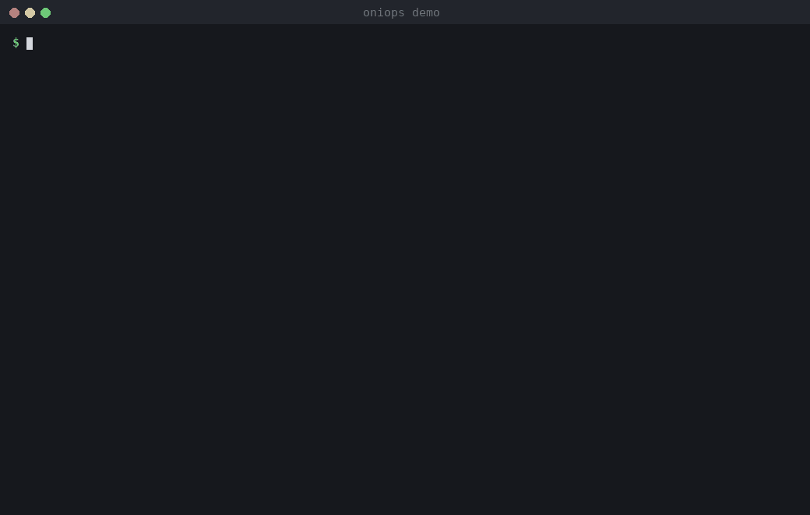
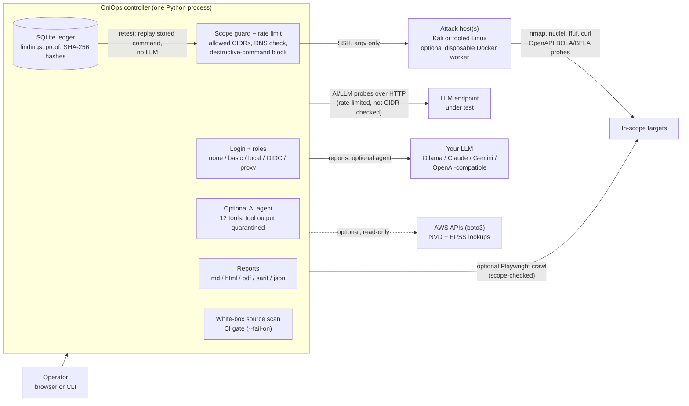

# OniOps

[](https://github.com/ares-369/oniops/actions/workflows/ci.yml)
[](LICENSE)
[](pyproject.toml)
[](https://pypi.org/project/oniops/)
[](https://github.com/ares-369/oniops/releases)

**An open-source red-team framework that runs your existing security tools against a fixed scope, checks each finding against evidence, and lets you retest it later without an LLM.**

OniOps runs tools such as nmap, nuclei and ffuf on a Kali (or any tooled Linux) host over SSH,
only against the hosts and ranges you allow. It keeps findings in one ledger, marks a finding
verified only when a proof rule matches the target's real response, and can replay that proof later
to check whether a fix worked. It also includes API access-control checks (BOLA/BFLA), probes for
LLM endpoints, and an optional AI assistant (local Ollama or a cloud model) that picks from a small,
fixed set of tools.

> **Beta, solo-maintained.** Most features are unit-tested but have had limited real-world
> testing. Treat findings as leads to verify, expect rough edges, and please
> [open an issue](https://github.com/ares-369/oniops/issues) when something is wrong. See
> [Known limitations](#known-limitations).



*A real `oniops demo` run against its bundled practice target (playback slowed; the run takes about
two seconds). It shows the workflow, not real-world detection. Rebuild it with
`scripts/make_demo_gif.py`.*

> **Authorized use only.** OniOps performs active, intrusive security testing. Run
> it only against systems you own or have **explicit written permission** to
> test. Unauthorized use is illegal in most jurisdictions.
>
> OniOps is provided as-is, for learning and authorized testing. You are
> responsible for how you use it — the author is not responsible for misuse,
> for harm to any person or organization, or for modified versions made by
> others. Please read the [Responsible Use and Disclaimer](DISCLAIMER.md).


| Attack-Surface Graph & Analytics | Findings Ledger & Retest |
| --- | --- |
|  |  |

---

## Quick start

Needs Python 3.10+.

**With pipx or pip** (config and data go to `~/.oniops`):

```bash
pipx install oniops                 # or: pip install oniops (inside a venv)
oniops demo                         # one-minute practice run, no config needed
oniops init                         # creates ~/.oniops/config.yaml and .env with a random secret key
oniops                              # web UI on http://127.0.0.1:8501
```

**From a checkout** (config and data stay in the checkout; use this to edit playbooks or run the
systemd/Docker setups below):

```bash
git clone https://github.com/ares-369/oniops.git oniops && cd oniops
bash scripts/install.sh            # venv + dependencies + config.yaml + .env (safe to re-run)
venv/bin/python -m oniops demo        # one-minute practice run, no config needed
venv/bin/python -m oniops             # web UI on http://127.0.0.1:8501
```

`scripts/install.sh` never overwrites an existing `config.yaml` or `.env`, and only
generates a random `ONIOPS_SECRET_KEY` when `.env` has none. For a real assessment you
still edit `config.yaml` (scope and attack host), see
[Step-by-step installation](#step-by-step-installation). To run it as a service, see
[Run as a systemd service](#option-d--bare-linux--systemd) or use Docker
([Option A](#option-a--docker-recommended-works-on-linuxwindowsmacos)).

---

## Features

- **Any LLM** — Ollama (local), Anthropic Claude, Google Gemini, OpenAI, Azure
  OpenAI, or any OpenAI-compatible endpoint. Per-role model selection.
- **Black-Box, Grey-Box (3-Tier BOLA/BFLA with JSON Content-Diffing) & Lightweight White-Box** — run
  unauthenticated recon, pass primary + low-privilege auth headers (`Authorization`
  / `Cookie`) to WAPT and the AI Agent, auto-discover OpenAPI/Swagger specs for
  3-tier `Unauth vs. Low-Priv vs. Admin` BOLA/BFLA differential checks (with response
  body & JSON schema validation to filter out HTML SPA shells and empty `{}` stubs), extract
  hidden API routes from SPA JavaScript bundles, and scan source code for routes
  and dangerous sinks.
- **Bounded browser discovery** — optional Playwright crawling renders JavaScript pages, inventories
  links, form methods and field metadata, and records API-call status/content type without response
  bodies or field values. It flags observed sensitive GET forms and cleartext credential forms,
  blocks mutating requests, and sends explicit auth headers only to the starting origin. Install with
  `pip install 'oniops[browser]'` and `playwright install chromium`.
- **Authenticated target sessions with refresh** — beyond a fixed auth header, OniOps can log in to a
  target per role (`primary` / `low_priv` / `peer`) via a `target_auth` config block: `json_login`
  (POST credentials, read a token from a JSON path, format a header — covers token APIs such as VAmPI
  and Juice Shop) or `form_login` (GET a CSRF token, POST form credentials, capture the session cookie
  — covers form logins such as DVWA). When a token expires mid-scan the role's session is re-minted
  once and the request retried, so short-lived JWTs (for example VAmPI's ~60s tokens) no longer
  collapse the access-control differential into anonymous requests. Credentials live only in config or
  the environment (`${ENV_VAR}`) and never reach findings, logs or reports. See
  [docs/TARGET_AUTH.md](docs/TARGET_AUTH.md).
- **41 Kali Arsenal Tools + 12 Bounded ReAct Agent Tools** — manages and executes a
  full catalog of **41 offensive tools** across YAML Playbooks, scan profiles, and the
  Arsenal UI, while restricting the optional AI agent loop to a curated subset of
  **12 deterministic tools** (`nmap`, `whatweb`, `httpx`, `nuclei`,
  `ffuf`, `nikto`, `wafw00f`, `sslscan`, `openapi_probe`, `report_finding`,
  `enum4linux`, `searchsploit`) so smaller local models have fewer ways to go wrong. Independently
  checks agent-submitted findings against live HTTP indicators before persisting to
  the ledger, condenses noisy tool output, wraps target responses in
  `<untrusted_tool_output>` delimiters, and syncs discovered ports with the
  Attack-Surface Graph.
- **Proof-First Evidence Ledger, Batch Zero-Token Retest & Drift Diffing** —
  stores structured findings with automatic secret redaction, 1-click single or
  batch deterministic SSH replay (`POST /api/findings/retest-all`: `VERIFIED` /
  `AUTH-GATED` / `FIXED` / `regressed`) with zero LLM tokens, and assessment
  posture drift diffing (`GET /api/assessments/<id>/diff`). Agent-proposed findings
  require a supported category proof and matching claim title; a model-supplied
  indicator by itself is never enough to mark a vulnerability verified.
- **Correlated Attack Paths & Blast Radius** — correlates open services,
  verified findings, and high-value internal ports into multi-stage attack paths
  with a `0–100` Blast Radius score.
- **Offline-first CVE, Exploit-DB & EPSS intelligence** — maps detected service
  banners to local Exploit-DB (`searchsploit`) advisories on your attack host
  with zero external dependencies, plus optional online NVD CVE/CVSS and **FIRST
  EPSS** 30-day exploitation probability enrichment.
- **Declarative YAML Playbooks & AI Probe Packs** — drop `.yaml` network/WAPT
  playbooks into `playbooks/` and custom AI safety probe packs into
  `playbooks/ai_probes/` without touching Python code. See [pack format](docs/SECURITY_PACKS.md).
- **Versioned security packs** — pack metadata includes semantic versions and content hashes; nested
  directories load and duplicate IDs are rejected.
- **Disposable scanner workers and local image scanning** — optionally run each scanner command in a
  non-root Docker worker with a read-only filesystem, dropped capabilities and resource limits.
  `oniops container-scan` scans an image already present on the attack host with Trivy offline; it never
  pulls an image.
- **Cloud identity posture checks** — optional AWS SDK checks use the local boto3 credential chain,
  verify the expected account ID with STS before inventory, and run read-only root/IAM MFA and key,
  password-policy (selectable AWS CIS-style or NIST 800-63B-4 profile), public security-group,
  public EKS API endpoint, S3 policy/ACL and encryption checks. Install with
  `pip install 'oniops[cloud]'`. EC2 and EKS inventory is limited to the selected `--region`; IAM
  and S3 inventory is account-level.
- **AI / LLM Red Team & GRC** — probe any LLM endpoint across **14 single-turn
  probes** (incl. RAG context poisoning, MCP tool-description poisoning, and
  cross-tenant leakage), **5 composable prompt converters** (`leetspeak`,
  `rot13`, `unicode_homoglyph`, `markdown_wrap`, `json_smuggle`), and a **3-turn
  Crescendo escalation loop**, mapped to OWASP LLM Top 10, MITRE ATLAS, NIST AI
  RMF, and Google SAIF / ISO 42001.
- **Safety and audit controls** — explicit CIDR/host scope allow-list with
  multi-record DNS rebinding and embedded command IP verification,
  non-destructive command guard, SHA-256 hashes of stored evidence,
  execution manifests with a SHA-256 hash (HMAC-SHA256 signed when
  `ONIOPS_SECRET_KEY` is set), SQLite WAL concurrent persistence,
  OWASP-compliant 600,000-iteration PBKDF2 password hashing, 3-tier RBAC
  (`viewer` / `operator` / `admin`), login brute-force rate limiting, CSRF
  same-origin protection, pause/stop on running jobs, and pluggable auth (`none`
  / `basic` / `local` / **OIDC SSO** / reverse-proxy).
- **Editable config in the UI** (with unified YAML diff preview before save),
  **report export (`.md` / `.html` / `.pdf` / `.sarif` / `.json`)**, and runs on
  Linux, Windows, Docker, and Proxmox LXC.

---

## Architecture



Everything that touches a target, including retests and the agent's tool calls, goes through the
scope guard and runs on the attack host. The optional browser crawl runs on the controller and is
scope-checked too. AI/LLM probes go straight from the controller to the endpoint you name; they are
rate-limited but not checked against `scope.allowed_cidrs`, because LLM endpoints are often cloud
URLs. Only point them at endpoints you are allowed to test.

### Naming and layout

The framework is **OniOps**. The PyPI/distribution name in `pyproject.toml` is `oniops`, the
command and the Python package are `oniops` (`oniops demo`, `python -m oniops`, `import oniops`), and the
repository is `ares-369/oniops`. They all refer to the same project. In a checkout, the web app
(`webui.py`, `templates/`, `static/`) and `playbooks/` sit at the top next to the `oniops/` package;
the pip package bundles copies of them, and keeps your `config.yaml`, `.env` and data in
`~/.oniops` (or `$ONIOPS_HOME`).

### How it works

OniOps has two parts you provide:

1. An **attack host** — a Kali or tooled Linux box that OniOps reaches over SSH
   (it runs the actual tools there). It can even be `localhost` if OniOps runs on
   the Kali box itself.
2. The **OniOps controller** — this app, which you install wherever is convenient
   on your network.

Optionally, an **LLM** (local Ollama needs no key; cloud providers need an API
key) powers the AI reports and the optional AI agent.

---

## Try it in one minute

You can see what OniOps does before setting up an attack host, SSH keys, an LLM
or a scope. With Python 3.10+ and `curl` installed. If you already ran the Quick start above, just
run the last command. Otherwise:

```bash
git clone https://github.com/ares-369/oniops.git oniops && cd oniops
python3 -m venv venv && venv/bin/pip install -r requirements.txt
venv/bin/python -m oniops demo
```

`oniops demo` starts a small, deliberately flawed practice app inside the same
process, bound to `127.0.0.1` on a random port, with fake data only. It then
probes that app with OniOps's real grey-box API checks and validators (scope
locked to `127.0.0.1/32`, every request is a local `curl`), prints what it found
with a proof snippet and fix-first score, replays every finding with the
zero-token retest (credentialed BOLA/BFLA findings are replayed as the
low-privilege or peer identity that proved them, shown masked), switches the
app to a "fixed" state and retests them again.
Everything it prints is labelled `[DEMO]`. Findings go into a temporary ledger
that is deleted afterwards (`--db PATH` keeps it); your real `oniops.sqlite` is
never opened. No LLM is called in demo mode.

The practice app was written by the author to exercise these checks, so the demo
shows how the pipeline works, not how well OniOps finds issues on arbitrary real
systems. It covers the deterministic parts only (service check,
OpenAPI BOLA/BFLA/BOPLA, GraphQL introspection, SQL-error and reflected-XSS
proofs); nmap, nuclei, ffuf and the other attack-host tools, CVE intel and the
AI agent are not part of it. The demo does not record terms acceptance; for any
real target you still accept the responsible-use terms in the web UI.

---

## Step-by-step installation

### Prerequisites

- An **attack host** reachable over SSH with your tools installed (Kali, Parrot,
  BlackArch, or your own box). You need its IP/hostname, a user, and an SSH
  **private key** that host trusts.
- **Docker** *or* **Python 3.10+** on the machine that will run the controller.
- (Optional) an LLM: a running **Ollama**, or an API key for Claude/Gemini/OpenAI.

### Option A — Docker (recommended, works on Linux/Windows/macOS)

```bash
# 1. Get the code
git clone https://github.com/ares-369/oniops.git oniops && cd oniops

# 2. Create your config and secrets files from the examples
cp config.example.yaml config.yaml
cp .env.example .env

# 3. Edit config.yaml — set at minimum:
#    scope.allowed_cidrs  (the network(s) you may test, e.g. ["192.168.1.0/24"])
#    kali.host / kali.user / kali.ssh_key  (your attack host)
#    llm.providers.ollama.base_url  (or configure a cloud provider)
#    auth.mode: "local"   (REQUIRED in Docker: the container listens on 0.0.0.0, and
#                          OniOps refuses to start without a login)
nano config.yaml

# 4. Put the attack host's SSH private key where config.yaml points
mkdir -p secrets && cp /path/to/kali_key secrets/kali_id_rsa && chmod 600 secrets/kali_id_rsa

# 5. In .env set ONIOPS_AUTH_PASSWORD and ONIOPS_SECRET_KEY (for example
#    python3 -c "import secrets;print(secrets.token_hex(32))"), and optionally cloud
#    API keys (ANTHROPIC_API_KEY, GEMINI_API_KEY, ...)
nano .env

# 6. Start it
docker compose up -d

# 7. Open the UI (published on this machine only) and log in
#    http://localhost:8501
```

Because the container must listen on `0.0.0.0` for the port mapping to work, OniOps will
not start in Docker until a login is configured. `ONIOPS_ALLOW_UNAUTHENTICATED_NETWORK` is
left commented out in `docker-compose.yml` on purpose; do not enable it unless the port is
reachable only by you.

The image is built from the `Dockerfile` by `docker compose up -d` (the first start takes a
few minutes). Keep `kali.known_hosts` pointing into `data/` (the example config does) because
`secrets/` is mounted read-only. `docker compose ps` shows the container health, which uses
`/healthz`.

To reach it from other machines, change the port mapping in `docker-compose.yml`
(the login from step 3 is then already in place).

If your attack host / LLM are on the same LAN as the Docker host, uncomment
`network_mode: host` in `docker-compose.yml`.

### Option B — Proxmox LXC

On a Proxmox VE host:

```bash
# Creates an unprivileged Debian container and installs OniOps as a service
CTID=950 bash deploy/proxmox-lxc.sh

# Then, inside the container:
#   edit /opt/oniops/config.yaml, drop your SSH key in /opt/oniops/secrets/, and:
pct exec 950 -- systemctl start oniops
# UI on the container's IP, port 8501 - set bind_host: "0.0.0.0" and a login first
```

By default OniOps listens on `127.0.0.1` only. To open it from other machines, set
`oniops.bind_host: "0.0.0.0"` **and** a login (`auth.mode`: basic, local, oidc or
proxy) in `config.yaml`. OniOps refuses to start on a network address without a login,
and refuses proxy mode without `auth.proxy_trusted_ips`.

### Option C — Windows (native, no WSL)

```powershell
# Requires Python 3.10+ (https://www.python.org)
powershell -ExecutionPolicy Bypass -File deploy\windows-install.ps1
# Edit config.yaml and put your SSH key in .\secrets\, then:
.\venv\Scripts\python.exe -m oniops
# UI on http://localhost:8501
```

### Option D — Bare Linux + systemd

The unit file [`deploy/systemd/oniops.service`](deploy/systemd/oniops.service) expects the install
in `/opt/oniops`. It runs `/opt/oniops/venv/bin/python -m oniops` from that directory with
`ONIOPS_CONFIG=/opt/oniops/config.yaml`; OniOps reads `/opt/oniops/.env` itself, so keep your
keys there. Data (the SQLite ledger and activity log) lives in `/opt/oniops/data`.

```bash
sudo useradd --system --home-dir /opt/oniops --shell /usr/sbin/nologin oniops
sudo git clone https://github.com/ares-369/oniops.git /opt/oniops
cd /opt/oniops
sudo bash scripts/install.sh              # venv, dependencies, config.yaml, .env, secret key
sudo nano config.yaml                      # set scope + attack host + LLM
sudo cp /path/to/kali_key secrets/kali_id_rsa && sudo chmod 600 secrets/kali_id_rsa
sudo chown -R oniops:oniops /opt/oniops             # the service runs as user "oniops" and writes data/
sudo -u oniops venv/bin/python -m oniops doctor  # check the setup before starting
sudo cp deploy/systemd/oniops.service /etc/systemd/system/oniops.service
sudo systemctl daemon-reload
sudo systemctl enable --now oniops
systemctl status oniops                       # logs: journalctl -u oniops -f
curl -s http://127.0.0.1:8501/healthz      # {"ok":true}
```

To install somewhere other than `/opt/oniops`, edit the three `/opt/oniops` paths in the unit
before copying it (for example
`sed 's#/opt/oniops#/srv/oniops#g' deploy/systemd/oniops.service | sudo tee /etc/systemd/system/oniops.service`).
Avoid `/home`: the unit sets `ProtectHome=true`. The unit runs as the unprivileged user
`oniops`; that user must own `data/` (it writes the ledger and `known_hosts` there) and be able
to read `config.yaml`, `.env` and `secrets/` (keep them `chmod 600`, owned by `oniops`).

By default OniOps listens on `127.0.0.1` only. To open it from other machines, set
`oniops.bind_host: "0.0.0.0"` **and** a login (`auth.mode`: basic, local, oidc or
proxy) in `config.yaml`. OniOps refuses to start on a network address without a login,
and refuses proxy mode without `auth.proxy_trusted_ips`.

Run OniOps from a checkout of this repository (`python -m oniops`, or `oniops` after
`pip install -e .` inside it). A plain `pip install .` installs the CLI, which is enough for
`oniops demo`, `doctor`, `whitebox` and the like, but not the web UI: `webui.py`, `templates/` and
`static/` are not part of the installed package, and `oniops serve` will say so.

More targets (WSL2, Raspberry Pi, cloud VM, Kubernetes, Unraid,
air-gapped) are covered in [`docs/INSTALL.md`](docs/INSTALL.md).

### Configuration files and environment variables

| What | Where | Notes |
| --- | --- | --- |
| `config.yaml` | `$ONIOPS_CONFIG`, else `./config.yaml`, else next to the `oniops/` package | Layout, scope, attack host, LLM roles. |
| `.env` | `./.env`, else next to the `oniops/` package | Secrets and API keys. Keep comments on their own lines. |
| `data/` | `data/` in the checkout (`/app/data` in Docker) | SQLite ledger `oniops.sqlite` and `activity.jsonl`. Back it up with `oniops backup`. |
| `ONIOPS_DB_PATH` | environment | Ledger path for CLI commands only (`findings`, `retest`, `diff`, `backup`, `restore`, `doctor`). The web UI always uses `data/oniops.sqlite`. |
| `ONIOPS_BIND_HOST` | environment | Overrides `oniops.bind_host` (Docker sets `0.0.0.0`). |
| `ONIOPS_ALLOW_UNAUTHENTICATED_NETWORK` | environment | Set to `1` only if something else restricts access. |
| `ONIOPS_SECRET_KEY` | `.env` | Signs sessions, manifests and webhooks. `scripts/install.sh` generates one. |
| `ONIOPS_PLAYBOOKS_DIR` | environment | Use a different playbooks folder. |

Health check for monitoring: `GET /healthz` returns HTTP 200 without a login.

---

## Minimal configuration

Everything environment-specific lives in `config.yaml` (layout) and `.env`
(secrets). The three things to set first:

```yaml
scope:
  allowed_cidrs: ["192.168.1.0/24"]   # OniOps refuses anything outside this
kali:
  host: "192.168.1.50"                 # your attack host
  user: "root"
  ssh_key: "./secrets/kali_id_rsa"
llm:
  roles:
    planner:  { provider: "ollama", model: "qwen2.5-coder:7b" }
    reporter: { provider: "ollama", model: "qwen2.5-coder:7b" }
  providers:
    ollama: { base_url: "http://localhost:11434" }
```

`scope.rate_limit_per_min` (default 120) paces each target separately: it
caps how many commands or HTTP requests OniOps launches toward any one target
per minute (one nmap run, curl call or AI probe request counts as one). It is
not a packet limit, since a single nmap or nikto run still sends many packets.
Commands that touch no target, such as `searchsploit`, are not counted. If a
target answers HTTP 429 or 503, OniOps slows down for that target, honors
`Retry-After` on direct HTTP probes (capped at 60 s), and after three retries
records the probe as throttled rather than passed.

See [`config.example.yaml`](config.example.yaml) for the full annotated file.

---

## Authentication & SSO

OniOps ships with **no login by default** (`auth.mode: none`). Because the UI can
drive the attack host, turn on auth whenever it is reachable beyond localhost:

- `basic` — HTTP Basic (single operator)
- `local` — built-in login page + session (`ONIOPS_AUTH_PASSWORD` + `ONIOPS_SECRET_KEY`)
- `oidc` — **SSO with any OpenID Connect provider** (Authentik, Keycloak, Google,
  Azure AD, Okta…); `pip install 'oniops[oidc]'`
- `proxy` — trust a reverse-proxy forward-auth header

`ONIOPS_SECRET_KEY` (or `auth.secret_key` in `config.yaml`) is also the key that
signs assessment manifests; webhook alerts are signed with `ONIOPS_SECRET_KEY`
from the environment only. Set it to a random value of 32+
bytes, for example `python -c "import secrets;print(secrets.token_hex(32))"`,
and keep it the same across restarts. If it is unset, manifests are still
produced with their SHA-256 hash but are marked unsigned, and webhooks carry no
signature header. OniOps does not sign with a per-process random key, because
such a signature could not be checked after a restart.

For production, front OniOps with a **TLS-terminating reverse proxy** (nginx/Caddy/
Traefik/NPM). See the Authentication section of `config.example.yaml`.

---

## Using OniOps

- **Recon Workbench** — run an assessment (fast recon, deep service, web-TLS,
  **WAPT**, or the autonomous PTT) against an in-scope IP/domain.
- **AI Agent** — give an objective; OniOps plans and runs scoped tools to a report.
- **Target Matrix / Attack Graph** — discover hosts (explicit, guarded) and see
  the surface; click a host to assess it.
- **Tooling Arsenal** — see/install tools on the attack host.
- **AI / LLM Red Team & GRC** — red-team an LLM endpoint and get a posture report.
- **Settings** — edit scope, hosts, providers and integrations live.

---

## CLI & CI/CD Security Gate

OniOps can be driven headlessly from a terminal, cron job, or CI/CD pipeline:

```bash
# Practice run against the bundled loopback target (no config needed)
python -m oniops demo

# Ground-truth run through the real assessment pipeline; reports fixture precision and recall
python -m oniops benchmark --demo-evaluation --json

# Score an assessment of a public vulnerable app (crAPI, Juice Shop, VAmPI) against labeled bugs
python -m oniops benchmark --suite vampi --target 10.10.0.5 --markdown   # see docs/BENCHMARKS.md

# Bounded browser discovery of a target inside the configured scope
python -m oniops crawl https://app.example.test --max-pages 50 --output crawl.json

# Scan a local image already loaded in the attack host's Docker daemon
python -m oniops container-scan my-app:latest --fail-on HIGH --output image-scan.json

# Read-only identity and exposure checks for one explicitly selected AWS account
python -m oniops cloud-audit aws --account-id 123456789012 --profile audit --region us-east-1

# Self-diagnostics (config, scope, SQLite integrity, playbooks, attack runner)
python -m oniops doctor --check-runner

# White-Box source & sink scan with SARIF v2.1.0 output and CI exit gate
python -m oniops whitebox ./src --fail-on HIGH --sarif results.sarif

# Run a scoped assessment from the CLI
python -m oniops assess 192.168.1.50 --profile web_app_pt

# Zero-token deterministic SSH PoC retest (single finding or batch)
python -m oniops retest --all --target 192.168.1.50

# Compare an assessment against its previous baseline
python -m oniops diff 2

# Online SQLite backup and verified restore
python -m oniops backup ./backups/oniops-snapshot.sqlite
python -m oniops restore ./backups/oniops-snapshot.sqlite
```

Run `python -m oniops --help` or `python -m oniops <command> --help` for every option. With no
command, `python -m oniops` starts the web UI.

To build the optional non-root scanner worker on the attack host:

```bash
docker build -f Dockerfile.worker -t oniops-worker:stable .
docker network create oniops-worker-net
```

Set `kali.execution_mode: docker` and `kali.worker_image: oniops-worker:stable` in
`config.yaml`. CI builds the image and smoke-tests Nmap and Nuclei as non-root
with a read-only filesystem and networking disabled during the smoke test. Each
worker starts in a pre-created user-defined bridge network namespace, applies an egress firewall
from the effective scope CIDRs (including exclusions), then drops its temporary
firewall capability and runs the scanner as `worker_user`. Docker host networking
is rejected because it would bypass that boundary. The configured CIDRs are
therefore the worker's network allowlist; DNS uses Docker's embedded resolver.
The configured Docker network must be user-defined (the default `oniops-worker-net`)
so the worker's DNS exception points only at Docker's embedded resolver.

---

## Where OniOps fits

There are many good, more mature tools in this space, and OniOps borrows ideas from a lot of them.
It is a small, self-hosted project by one person, not a replacement for any of them. If one of the
tools below already does what you need, it is probably the better choice today.

| If you mainly need… | Well-established options | Where OniOps is different |
| --- | --- | --- |
| An AI-driven pentest agent | [PentAGI](https://github.com/vxcontrol/pentagi), [Strix](https://github.com/usestrix/strix) | Its agent is deliberately limited to 12 tools; most work runs as fixed playbooks |
| LLM red-teaming | [garak](https://github.com/NVIDIA/garak), [promptfoo](https://github.com/promptfoo/promptfoo), [PyRIT](https://github.com/Azure/PyRIT) | Far fewer probes; they sit in the same ledger as network/web findings |
| Web/network scanning | [Nuclei](https://github.com/projectdiscovery/nuclei), [OWASP ZAP](https://www.zaproxy.org) | OniOps runs tools like Nuclei; it does not replace them |
| Cloud posture | [Prowler](https://github.com/prowler-cloud/prowler), [ScoutSuite](https://github.com/nccgroup/ScoutSuite) | Only a handful of read-only AWS checks |
| Commercial autonomous pentesting | NodeZero, XBOW | Free and self-hosted, with far less coverage and no support |

### Known limitations

- **No published detection results yet.** A [benchmark harness](docs/BENCHMARKS.md) for crAPI,
  OWASP Juice Shop and VAmPI exists, but no scored results are published. One small early lab run
  on VAmPI found its real unauthenticated API exposures without false positives, but **missed**
  authenticated horizontal BOLA on parameterised routes (for example `/users/v1/{username}`).
  Later versions try real peer-owned object IDs for this case; that has not been re-measured yet.
- **`oniops demo` is a practice run** against a small bundled target with planted bugs. It shows how
  the workflow looks; it says nothing about how well OniOps finds bugs in real applications. The
  demo self-test measures only that fixture.
- **It is not an exploitation framework.** Built-in checks confirm issues with non-destructive
  requests. Playbooks that run intrusive tools (sqlmap, hydra) are refused unless you set
  `scope.allow_intrusive_playbooks: true`. The Arsenal page can install tools such as Metasploit on
  your attack host, but OniOps does not drive them or chain exploits for you.
- **The AI agent is optional and narrow.** Most value comes from the deterministic playbooks; the
  agent can still pick poor next steps, especially with small local models.
- **New packaging.** The pip/pipx install is new in this release and so far tested on Linux only;
  the checkout install (`scripts/install.sh`) and Docker are the longer-tested paths.
- **Breadth over depth.** Many features (cloud checks, browser crawl, container scan) are new and
  field-untested.

## Acknowledgements

OniOps stands on the shoulders of the open-source security community. It
orchestrates tools such as [Nmap](https://nmap.org),
[Nuclei](https://github.com/projectdiscovery/nuclei),
[httpx](https://github.com/projectdiscovery/httpx),
[ffuf](https://github.com/ffuf/ffuf), [Nikto](https://github.com/sullo/nikto),
[WhatWeb](https://github.com/urbanadventurer/WhatWeb) and
[Exploit-DB / searchsploit](https://www.exploit-db.com), and its AI red-team
probes were informed by the research behind garak, PyRIT, promptfoo and
DeepTeam. Thank you to everyone who builds and maintains them.

---

## Security

OniOps tries to follow the same security guidance it tests for — see
[`SECURITY.md`](SECURITY.md). If you find a vulnerability in OniOps itself,
please report it privately.

## Contributing

Contributions of all sizes are welcome — bug reports, ideas, docs and code.
See [`CONTRIBUTING.md`](CONTRIBUTING.md) to get started, and
[`CHANGELOG.md`](CHANGELOG.md) for what has changed between releases.

## Disclaimer

OniOps is a tool for learning and for testing systems you are authorized to test.
It is provided "as is", without warranty. You are solely responsible for your
use of it; the author accepts no liability for misuse, for any damage or harm
caused to people, companies, or systems, or for modified versions, forks, or
redistributions made by others. See [`DISCLAIMER.md`](DISCLAIMER.md) and
[`NOTICE`](NOTICE).

## License

Apache-2.0. See [`LICENSE`](LICENSE). Redistributions, including modified
versions, must keep the [`NOTICE`](NOTICE) file.
