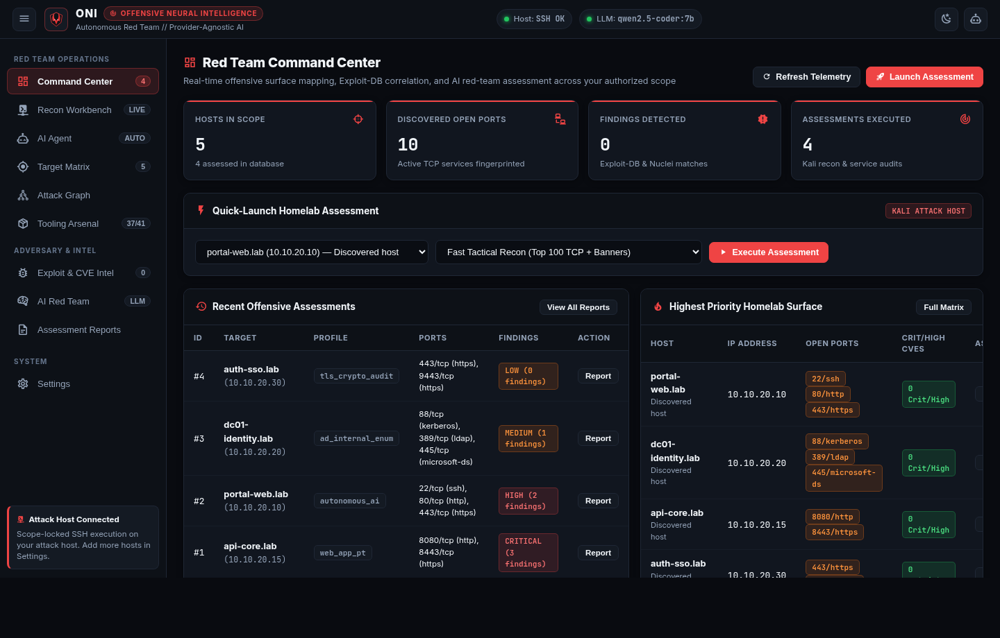
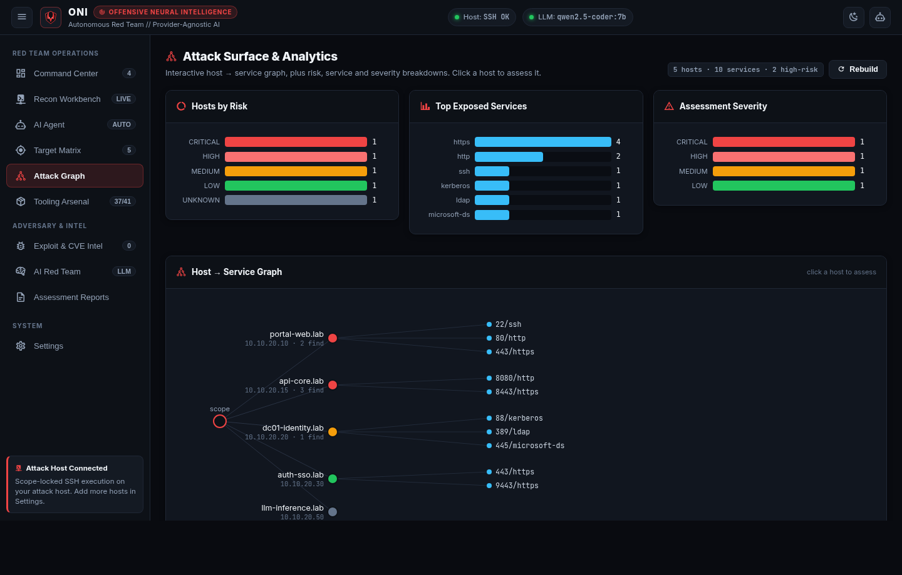
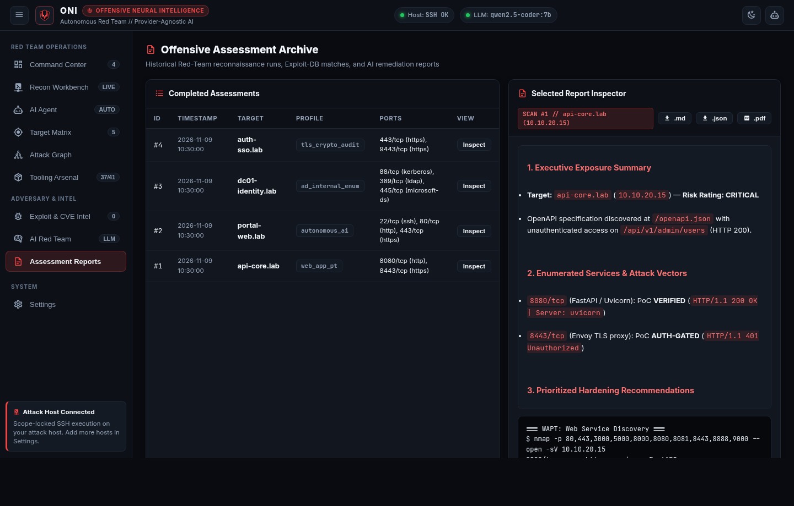
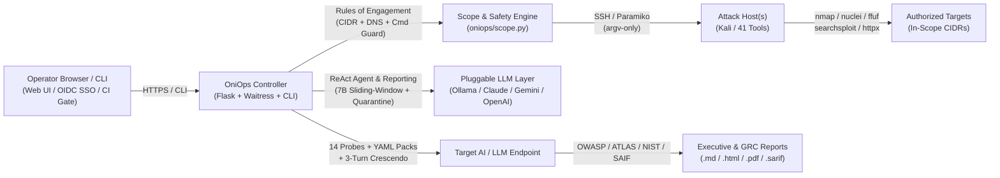

# OniOps — Offensive Neural Intelligence

[](https://github.com/ares-369/oniops/actions/workflows/ci.yml)
[](LICENSE)
[](pyproject.toml)
[](https://github.com/ares-369/oniops/releases)

**An open-source, provider-agnostic, autonomous red-team framework.**

OniOps drives a Kali (or any tooled Linux) toolchain over SSH, reasons with the
LLM(s) of your choice — local or cloud — and runs scope-locked offensive
assessments against systems you are authorized to test. It pairs classic
pentest/WAPT tooling with an autonomous AI operator, an attack-surface graph,
and an AI/LLM red-team + GRC module, behind pluggable authentication.

> **Authorized use only.** OniOps performs active, intrusive security testing. Run
> it only against systems you own or have **explicit written permission** to
> test. Unauthorized use is illegal in most jurisdictions.
>
> OniOps is provided as-is, for learning and authorized testing. You are
> responsible for how you use it — the author is not responsible for misuse,
> for harm to any person or organization, or for modified versions made by
> others. Please read the [Responsible Use and Disclaimer](DISCLAIMER.md).



| Attack-Surface Graph & Analytics | Proof-First Findings & Zero-Token Retest |
| --- | --- |
|  |  |

---

## Features

- **Any LLM** — Ollama (local), Anthropic Claude, Google Gemini, OpenAI, Azure
  OpenAI, or any OpenAI-compatible endpoint. Per-role model selection.
- **Black-Box, Grey-Box (3-Tier BOLA/BFLA with JSON Content-Diffing) & Lightweight White-Box** — run
  unauthenticated recon, pass primary + low-privilege auth headers (`Authorization`
  / `Cookie`) to WAPT and the AI Agent, auto-discover OpenAPI/Swagger specs for
  3-tier `Unauth vs. Low-Priv vs. Admin` BOLA/BFLA differential checks (with response
  body & JSON schema validation to filter out HTML SPA shells and empty `{}` stubs), extract
  hidden API routes from SPA JavaScript bundles, and scan source code for routes
  and dangerous sinks.
- **41 Kali Arsenal Tools + 12 Bounded ReAct Agent Tools** — manages and executes a
  full catalog of **41 offensive tools** across YAML Playbooks, scan profiles, and the
  Arsenal UI, while restricting the autonomous LLM ReAct loop to a curated subset of
  **12 deterministic tools** (`nmap`, `whatweb`, `httpx`, `nuclei`,
  `ffuf`, `nikto`, `wafw00f`, `sslscan`, `openapi_probe`, `report_finding`,
  `enum4linux`, `searchsploit`) so local 7B models never hallucinate flags. Independently
  verifies agent-submitted findings against live HTTP indicators before persisting to
  the ledger, condenses noisy tool output, wraps target responses in
  `<untrusted_tool_output>` delimiters, and syncs discovered ports with the
  Attack-Surface Graph.
- **Proof-First Evidence Ledger, Batch Zero-Token Retest & Drift Diffing** —
  stores structured findings with automatic secret redaction, 1-click single or
  batch deterministic SSH replay (`POST /api/findings/retest-all`: `VERIFIED` /
  `AUTH-GATED` / `FIXED` / `regressed`) with zero LLM tokens, and assessment
  posture drift diffing (`GET /api/assessments/<id>/diff`).
- **Correlated Attack Paths & Blast Radius** — correlates open services,
  verified findings, and high-value internal ports into multi-stage attack paths
  with a `0–100` Blast Radius score.
- **Offline-first CVE, Exploit-DB & EPSS intelligence** — maps detected service
  banners to local Exploit-DB (`searchsploit`) advisories on your attack host
  with zero external dependencies, plus optional online NVD CVE/CVSS and **FIRST
  EPSS** 30-day exploitation probability enrichment.
- **Declarative YAML Playbooks & AI Probe Packs** — drop `.yaml` network/WAPT
  playbooks into `playbooks/` and custom AI safety probe packs into
  `playbooks/ai_probes/` without touching Python code.
- **AI / LLM Red Team & GRC** — probe any LLM endpoint across **14 single-turn
  probes** (incl. RAG context poisoning, MCP tool-description poisoning, and
  cross-tenant leakage), **6 composable prompt converters** (`leetspeak`,
  `rot13`, `unicode_homoglyph`, `markdown_wrap`, `json_smuggle`), and a **3-turn
  Crescendo escalation loop**, mapped to OWASP LLM Top 10, MITRE ATLAS, NIST AI
  RMF, and Google SAIF / ISO 42001.
- **Safe & reproducible by design** — explicit CIDR/host scope allow-list with
  multi-record DNS rebinding and embedded command IP verification,
  non-destructive command guard, SHA-256 cryptographic evidence provenance,
  HMAC-SHA256 signed execution manifests, SQLite WAL concurrent persistence,
  OWASP-compliant 600,000-iteration PBKDF2 password hashing, 3-tier RBAC
  (`viewer` / `operator` / `admin`), login brute-force rate limiting, CSRF
  same-origin protection, pause/stop on running jobs, and pluggable auth (`none`
  / `basic` / `local` / **OIDC SSO** / reverse-proxy).
- **Editable config in the UI** (with unified YAML diff preview before save),
  **report export (`.md` / `.html` / `.pdf` / `.sarif` / `.json`)**, and runs on
  Linux, Windows, Docker, and Proxmox LXC.

---

## Architecture



### How it works

OniOps has two parts you provide:

1. An **attack host** — a Kali or tooled Linux box that OniOps reaches over SSH
   (it runs the actual tools there). It can even be `localhost` if OniOps runs on
   the Kali box itself.
2. The **OniOps controller** — this app, which you install wherever is convenient
   on your network.

Optionally, an **LLM** (local Ollama needs no key; cloud providers need an API
key) powers the AI reports and the autonomous agent.

---

## Step-by-step installation

### Prerequisites

- An **attack host** reachable over SSH with your tools installed (Kali, Parrot,
  BlackArch, or your own box). You need its IP/hostname, a user, and an SSH
  **private key** that host trusts.
- **Docker** *or* **Python 3.10+** on the machine that will run the controller.
- (Optional) an LLM: a running **Ollama**, or an API key for Claude/Gemini/OpenAI.

### Option A — Docker (recommended, works on Linux/Windows/macOS)

```bash
# 1. Get the code
git clone https://github.com/ares-369/oniops.git oniops && cd oniops

# 2. Create your config and secrets files from the examples
cp config.example.yaml config.yaml
cp .env.example .env

# 3. Edit config.yaml — set at minimum:
#    scope.allowed_cidrs  (the network(s) you may test, e.g. ["192.168.1.0/24"])
#    kali.host / kali.user / kali.ssh_key  (your attack host)
#    llm.providers.ollama.base_url  (or configure a cloud provider)
nano config.yaml

# 4. Put the attack host's SSH private key where config.yaml points
mkdir -p secrets && cp /path/to/kali_key secrets/kali_id_rsa && chmod 600 secrets/kali_id_rsa

# 5. (Optional) add cloud API keys to .env (ANTHROPIC_API_KEY, GEMINI_API_KEY, ...)

# 6. Start it
docker compose up -d

# 7. Open the UI (published on this machine only)
#    http://localhost:8501
```

To reach it from other machines, change the port mapping in `docker-compose.yml`,
remove the `ONIOPS_ALLOW_UNAUTHENTICATED_NETWORK` line there, and enable a login
(`auth.mode`) in `config.yaml`. OniOps refuses to start exposed without a login.

If your attack host / LLM are on the same LAN as the Docker host, uncomment
`network_mode: host` in `docker-compose.yml`.

### Option B — Proxmox LXC

On a Proxmox VE host:

```bash
# Creates an unprivileged Debian container and installs OniOps as a service
CTID=950 bash deploy/proxmox-lxc.sh

# Then, inside the container:
#   edit /opt/oniops/config.yaml, drop your SSH key in /opt/oniops/secrets/, and:
pct exec 950 -- systemctl start oniops
# UI on the container's IP, port 8501 - set bind_host: "0.0.0.0" and a login first
```

By default OniOps listens on `127.0.0.1` only. To open it from other machines, set
`oniops.bind_host: "0.0.0.0"` **and** a login (`auth.mode`: basic, local, oidc or
proxy) in `config.yaml`. OniOps refuses to start on a network address without a login,
and refuses proxy mode without `auth.proxy_trusted_ips`.

### Option C — Windows (native, no WSL)

```powershell
# Requires Python 3.10+ (https://www.python.org)
powershell -ExecutionPolicy Bypass -File deploy\windows-install.ps1
# Edit config.yaml and put your SSH key in .\secrets\, then:
.\venv\Scripts\python.exe -m oniops
# UI on http://localhost:8501
```

### Option D — Bare Linux + systemd

```bash
git clone https://github.com/ares-369/oniops.git oniops && cd oniops
python3 -m venv venv && ./venv/bin/pip install -r requirements.txt
cp config.example.yaml config.yaml && cp .env.example .env
nano config.yaml                       # set scope + attack host + LLM
mkdir -p secrets data                   # add your SSH key to secrets/
sudo cp deploy/systemd/oniops.service /etc/systemd/system/
sudo systemctl enable --now oniops
# UI on http://127.0.0.1:8501 (see below to open it to your network)
```

By default OniOps listens on `127.0.0.1` only. To open it from other machines, set
`oniops.bind_host: "0.0.0.0"` **and** a login (`auth.mode`: basic, local, oidc or
proxy) in `config.yaml`. OniOps refuses to start on a network address without a login,
and refuses proxy mode without `auth.proxy_trusted_ips`.

More targets (pipx, WSL2, Raspberry Pi, cloud VM, Kubernetes, Unraid,
air-gapped) are covered in [`docs/INSTALL.md`](docs/INSTALL.md).

---

## Minimal configuration

Everything environment-specific lives in `config.yaml` (layout) and `.env`
(secrets). The three things to set first:

```yaml
scope:
  allowed_cidrs: ["192.168.1.0/24"]   # OniOps refuses anything outside this
kali:
  host: "192.168.1.50"                 # your attack host
  user: "root"
  ssh_key: "./secrets/kali_id_rsa"
llm:
  roles:
    planner:  { provider: "ollama", model: "qwen2.5-coder:7b" }
    reporter: { provider: "ollama", model: "qwen2.5-coder:7b" }
  providers:
    ollama: { base_url: "http://localhost:11434" }
```

See [`config.example.yaml`](config.example.yaml) for the full annotated file.

---

## Authentication & SSO

OniOps ships with **no login by default** (`auth.mode: none`). Because the UI can
drive the attack host, turn on auth whenever it is reachable beyond localhost:

- `basic` — HTTP Basic (single operator)
- `local` — built-in login page + session (`ONIOPS_AUTH_PASSWORD` + `ONIOPS_SECRET_KEY`)
- `oidc` — **SSO with any OpenID Connect provider** (Authentik, Keycloak, Google,
  Azure AD, Okta…); `pip install 'oniops[oidc]'`
- `proxy` — trust a reverse-proxy forward-auth header

For production, front OniOps with a **TLS-terminating reverse proxy** (nginx/Caddy/
Traefik/NPM). See the Authentication section of `config.example.yaml`.

---

## Using OniOps

- **Recon Workbench** — run an assessment (fast recon, deep service, web-TLS,
  **WAPT**, or the autonomous PTT) against an in-scope IP/domain.
- **AI Agent** — give an objective; OniOps plans and runs scoped tools to a report.
- **Target Matrix / Attack Graph** — discover hosts (explicit, guarded) and see
  the surface; click a host to assess it.
- **Tooling Arsenal** — see/install tools on the attack host.
- **AI / LLM Red Team & GRC** — red-team an LLM endpoint and get a posture report.
- **Settings** — edit scope, hosts, providers and integrations live.

---

## CLI & CI/CD Security Gate

OniOps can be driven headlessly from a terminal, cron job, or CI/CD pipeline:

```bash
# Self-diagnostics (config, scope, SQLite integrity, playbooks, attack runner)
python -m oniops doctor --check-runner

# White-Box source & sink scan with SARIF v2.1.0 output and CI exit gate
python -m oniops whitebox ./src --fail-on HIGH --sarif results.sarif

# Run a scoped assessment from the CLI
python -m oniops assess 192.168.1.50 --profile web_app_pt

# Zero-token deterministic SSH PoC retest (single finding or batch)
python -m oniops retest --all --target 192.168.1.50

# Compare an assessment against its previous baseline
python -m oniops diff 2

# Online SQLite backup and verified restore
python -m oniops backup ./backups/oniops-snapshot.sqlite
python -m oniops restore ./backups/oniops-snapshot.sqlite
```

---

## Where OniOps Fits

There are excellent tools in this space, and OniOps borrows ideas from many of
them. It is not trying to replace any of them — it aims to be a small,
self-hostable option that combines classic pentest tooling with an AI operator
and LLM red-teaming in one place.

| If you want… | Also look at | What OniOps tries to add |
| --- | --- | --- |
| A mature autonomous pentest agent | [PentAGI](https://github.com/vxcontrol/pentagi), [Strix](https://github.com/usestrix/strix) | A lightweight single-process deploy (Python + SQLite + SSH to your own Kali box) |
| Dedicated LLM vulnerability scanning | [garak](https://github.com/NVIDIA/garak), [promptfoo](https://github.com/promptfoo/promptfoo), [PyRIT](https://github.com/Azure/PyRIT) | LLM probes side by side with network/web testing, mapped to OWASP LLM Top 10, MITRE ATLAS, NIST AI RMF |
| Enterprise autonomous pentesting | Commercial platforms such as NodeZero or XBOW | A free, open-source, homelab-to-small-team option you fully control |

OniOps is **beta** software. Many features are unit-tested but have had limited
real-world testing — please treat findings as leads to verify, and
[open an issue](https://github.com/ares-369/oniops/issues) when something is wrong.

## Acknowledgements

OniOps stands on the shoulders of the open-source security community. It
orchestrates tools such as [Nmap](https://nmap.org),
[Nuclei](https://github.com/projectdiscovery/nuclei),
[httpx](https://github.com/projectdiscovery/httpx),
[ffuf](https://github.com/ffuf/ffuf), [Nikto](https://github.com/sullo/nikto),
[WhatWeb](https://github.com/urbanadventurer/WhatWeb) and
[Exploit-DB / searchsploit](https://www.exploit-db.com), and its AI red-team
probes were informed by the research behind garak, PyRIT, promptfoo and
DeepTeam. Thank you to everyone who builds and maintains them.

---

## Security

OniOps tries to follow the same security guidance it tests for — see
[`SECURITY.md`](SECURITY.md). If you find a vulnerability in OniOps itself,
please report it privately.

## Contributing

Contributions of all sizes are welcome — bug reports, ideas, docs and code.
See [`CONTRIBUTING.md`](CONTRIBUTING.md) to get started, and
[`CHANGELOG.md`](CHANGELOG.md) for what has changed between releases.

## Disclaimer

OniOps is a tool for learning and for testing systems you are authorized to test.
It is provided "as is", without warranty. You are solely responsible for your
use of it; the author accepts no liability for misuse, for any damage or harm
caused to people, companies, or systems, or for modified versions, forks, or
redistributions made by others. See [`DISCLAIMER.md`](DISCLAIMER.md) and
[`NOTICE`](NOTICE).

## License

Apache-2.0. See [`LICENSE`](LICENSE). Redistributions, including modified
versions, must keep the [`NOTICE`](NOTICE) file.
