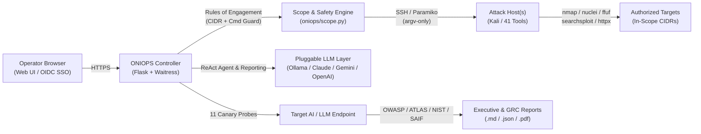

# ONIOPS — Offensive Neural Intelligence

**An open-source, provider-agnostic, autonomous red-team framework (`v0.2.0-beta`).**

ONIOPS drives a Kali (or any tooled Linux) toolchain over SSH, reasons with the
LLM(s) of your choice — local or cloud — and runs scope-locked offensive
assessments against systems you are authorized to test. It pairs classic
pentest/WAPT tooling with an autonomous AI operator, an attack-surface graph,
and an AI/LLM red-team + GRC module, behind pluggable authentication.

> **Authorized use only.** ONIOPS performs active, intrusive security testing. Run
> it only against systems you own or have **explicit written permission** to
> test. Unauthorized use is illegal in most jurisdictions. See [`NOTICE`](NOTICE).


| Attack-Surface Graph & Analytics | Proof-First Findings & Zero-Token Retest |
| --- | --- |
|  |  |

---

## Features

- **Any LLM** — Ollama (local), Anthropic Claude, Google Gemini, OpenAI, Azure
  OpenAI, or any OpenAI-compatible endpoint. Per-role model selection.
- **Black-Box, Grey-Box (3-Tier BOLA/BFLA) & Lightweight White-Box** — run
  unauthenticated recon, pass primary + low-privilege auth headers (`Authorization`
  / `Cookie`) to WAPT and the AI Agent, auto-discover OpenAPI/Swagger specs for
  3-tier `Unauth vs. Low-Priv vs. Admin` BOLA/BFLA differential checks, extract
  hidden API routes from SPA JavaScript bundles, and scan source code for routes
  and dangerous sinks.
- **Autonomous ReAct Agent with Independent Validator, Graph Memory & Quarantine** —
  plans and executes 12 scoped tools (`nmap`, `whatweb`, `httpx`, `nuclei`,
  `ffuf`, `nikto`, `wafw00f`, `sslscan`, `openapi_probe`, `report_finding`,
  `enum4linux`, `searchsploit`), independently verifies agent-submitted findings
  against live HTTP indicators before persisting to the ledger, condenses noisy
  tool output for local 7B models, wraps target responses in
  `<untrusted_tool_output>` delimiters, and syncs discovered ports with the
  Attack-Surface Graph.
- **Proof-First Evidence Ledger, Batch Zero-Token Retest & Drift Diffing** —
  stores structured findings with automatic secret redaction, 1-click single or
  batch deterministic SSH replay (`POST /api/findings/retest-all`: `VERIFIED` /
  `AUTH-GATED` / `FIXED` / `regressed`) with zero LLM tokens, and assessment
  posture drift diffing (`GET /api/assessments/<id>/diff`).
- **Correlated Attack Paths & Blast Radius** — correlates open services,
  verified findings, and high-value internal ports into multi-stage attack paths
  with a `0–100` Blast Radius score.
- **Offline-first CVE & exploit intelligence** — maps detected service banners
  to local Exploit-DB (`searchsploit`) advisories on your attack host with zero
  external dependencies, plus optional online NVD CVE/CVSS enrichment.
- **Declarative YAML Playbooks & AI Probe Packs** — drop `.yaml` network/WAPT
  playbooks into `playbooks/` and custom AI safety probe packs into
  `playbooks/ai_probes/` without touching Python code.
- **AI / LLM Red Team & GRC** — probe any LLM endpoint across **14 single-turn
  probes** (incl. RAG context poisoning, MCP tool-description poisoning, and
  cross-tenant leakage), **6 composable prompt converters** (`leetspeak`,
  `rot13`, `unicode_homoglyph`, `markdown_wrap`, `json_smuggle`), and a **3-turn
  Crescendo escalation loop**, mapped to OWASP LLM Top 10, MITRE ATLAS, NIST AI
  RMF, and Google SAIF / ISO 42001.
- **Safe by design** — explicit scope allow-list, non-destructive by default, a
  destructive-command guard, no auto-scanning, pause/stop on running jobs, and
  pluggable auth (`none` / `basic` / `local` / **OIDC SSO** / reverse-proxy).
- **Editable config in the UI** (with unified YAML diff preview before save),
  **report export (`.md` / `.json` / `.pdf`)**, and runs on Linux, Windows,
  Docker, and Proxmox LXC.

---

## Architecture



### How it works

ONIOPS has two parts you provide:

1. An **attack host** — a Kali or tooled Linux box that ONIOPS reaches over SSH
   (it runs the actual tools there). It can even be `localhost` if ONIOPS runs on
   the Kali box itself.
2. The **ONIOPS controller** — this app, which you install wherever is convenient
   on your network.

Optionally, an **LLM** (local Ollama needs no key; cloud providers need an API
key) powers the AI reports and the autonomous agent.

---

## Step-by-step installation

### Prerequisites

- An **attack host** reachable over SSH with your tools installed (Kali, Parrot,
  BlackArch, or your own box). You need its IP/hostname, a user, and an SSH
  **private key** that host trusts.
- **Docker** *or* **Python 3.10+** on the machine that will run the controller.
- (Optional) an LLM: a running **Ollama**, or an API key for Claude/Gemini/OpenAI.

### Option A — Docker (recommended, works on Linux/Windows/macOS)

```bash
# 1. Get the code
git clone https://github.com/ares-369/oniops.git oniops && cd oniops

# 2. Create your config and secrets files from the examples
cp config.example.yaml config.yaml
cp .env.example .env

# 3. Edit config.yaml — set at minimum:
#    scope.allowed_cidrs  (the network(s) you may test, e.g. ["192.168.1.0/24"])
#    kali.host / kali.user / kali.ssh_key  (your attack host)
#    llm.providers.ollama.base_url  (or configure a cloud provider)
nano config.yaml

# 4. Put the attack host's SSH private key where config.yaml points
mkdir -p secrets && cp /path/to/kali_key secrets/kali_id_rsa && chmod 600 secrets/kali_id_rsa

# 5. (Optional) add cloud API keys to .env (ANTHROPIC_API_KEY, GEMINI_API_KEY, ...)

# 6. Start it
docker compose up -d

# 7. Open the UI
#    http://localhost:8501   (or your Docker host's IP)
```

If your attack host / LLM are on the same LAN as the Docker host, uncomment
`network_mode: host` in `docker-compose.yml`.

### Option B — Proxmox LXC

On a Proxmox VE host:

```bash
# Creates an unprivileged Debian container and installs ONIOPS as a service
CTID=950 bash deploy/proxmox-lxc.sh

# Then, inside the container:
#   edit /opt/oniops/config.yaml, drop your SSH key in /opt/oniops/secrets/, and:
pct exec 950 -- systemctl start oniops
# UI is on the container's IP, port 8501
```

### Option C — Windows (native, no WSL)

```powershell
# Requires Python 3.10+ (https://www.python.org)
powershell -ExecutionPolicy Bypass -File deploy\windows-install.ps1
# Edit config.yaml and put your SSH key in .\secrets\, then:
.\venv\Scripts\python.exe -m oniops
# UI on http://localhost:8501
```

### Option D — Bare Linux + systemd

```bash
git clone https://github.com/ares-369/oniops.git oniops && cd oniops
python3 -m venv venv && ./venv/bin/pip install -r requirements.txt
cp config.example.yaml config.yaml && cp .env.example .env
nano config.yaml                       # set scope + attack host + LLM
mkdir -p secrets data                   # add your SSH key to secrets/
sudo cp deploy/systemd/oniops.service /etc/systemd/system/
sudo systemctl enable --now oniops
# UI on http://<host>:8501
```

More targets (pipx, WSL2, Raspberry Pi, cloud VM, Kubernetes, Unraid,
air-gapped) are covered in [`docs/INSTALL.md`](docs/INSTALL.md).

---

## Minimal configuration

Everything environment-specific lives in `config.yaml` (layout) and `.env`
(secrets). The three things to set first:

```yaml
scope:
  allowed_cidrs: ["192.168.1.0/24"]   # ONIOPS refuses anything outside this
kali:
  host: "192.168.1.50"                 # your attack host
  user: "root"
  ssh_key: "./secrets/kali_id_rsa"
llm:
  roles:
    planner:  { provider: "ollama", model: "qwen2.5-coder:7b" }
    reporter: { provider: "ollama", model: "qwen2.5-coder:7b" }
  providers:
    ollama: { base_url: "http://localhost:11434" }
```

See [`config.example.yaml`](config.example.yaml) for the full annotated file.

---

## Authentication & SSO

ONIOPS ships with **no login by default** (`auth.mode: none`). Because the UI can
drive the attack host, turn on auth whenever it is reachable beyond localhost:

- `basic` — HTTP Basic (single operator)
- `local` — built-in login page + session (`ONIOPS_AUTH_PASSWORD` + `ONIOPS_SECRET_KEY`)
- `oidc` — **SSO with any OpenID Connect provider** (Authentik, Keycloak, Google,
  Azure AD, Okta…); `pip install 'oniops[oidc]'`
- `proxy` — trust a reverse-proxy forward-auth header

For production, front ONIOPS with a **TLS-terminating reverse proxy** (nginx/Caddy/
Traefik/NPM). See the Authentication section of `config.example.yaml`.

---

## Using ONIOPS

- **Recon Workbench** — run an assessment (fast recon, deep service, web-TLS,
  **WAPT**, or the autonomous PTT) against an in-scope IP/domain.
- **AI Agent** — give an objective; ONIOPS plans and runs scoped tools to a report.
- **Target Matrix / Attack Graph** — discover hosts (explicit, guarded) and see
  the surface; click a host to assess it.
- **Tooling Arsenal** — see/install tools on the attack host.
- **AI / LLM Red Team & GRC** — red-team an LLM endpoint and get a posture report.
- **Settings** — edit scope, hosts, providers and integrations live.

---

## Security

ONIOPS is itself hardened to the frameworks it tests against — see
[`SECURITY.md`](SECURITY.md). Report vulnerabilities privately.

## Contributing

See [`CONTRIBUTING.md`](CONTRIBUTING.md). The project name is fixed as **ONIOPS**.

## License

Apache-2.0. See [`LICENSE`](LICENSE).
